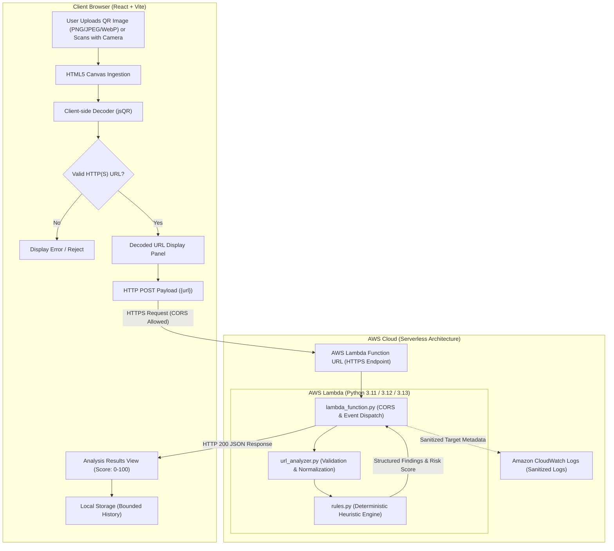

# QRShield — System Architecture

QRShield is a serverless, privacy-preserving cybersecurity web application designed to analyze potentially malicious URLs embedded within physical or digital QR codes.

## 1. Architectural Philosophy

1. **Client-Side Image Privacy (Zero-Knowledge Image Ingestion):**
   QR code decoding is performed 100% inside the user's browser via HTML5 Canvas and `jsQR`. User images never touch the network, eliminating bandwidth overhead, reducing cloud attack surfaces, and safeguarding user privacy.

2. **Stateless Serverless Execution (AWS Lambda Function URLs):**
   The threat analysis engine runs entirely on AWS Lambda without persistent EC2 servers, containers, or dedicated API Gateways. The compute layer wakes on demand and scales to zero, incurring zero idle costs.

3. **Deterministic Heuristic Engine:**
   Static URL threat inspection evaluates syntax, domain composition, credential embedding, port anomalies, and brand spoofing patterns deterministically. No probabilistic black-box or paid external threat feeds are required for baseline inspection.

4. **Sanitized Telemetry (Amazon CloudWatch):**
   The handler logs only a redacted endpoint for each request; AWS Lambda automatically adds its own execution duration line. URL credentials and sensitive query tokens are scrubbed prior to writing to CloudWatch.

---

## 2. End-to-End System Architecture Diagram

---

## 3. Data Flow Specification

| Step | Component | Action | Privacy & Security Controls |
|---|---|---|---|
| **1** | Frontend | User drops a QR image into the browser, or scans it with the camera | Client validates MIME type & enforces 5 MB limit; camera access needs the user's permission and HTTPS. |
| **2** | Browser Engine | Canvas extracts pixel data (image or camera frame) & runs `jsQR` | Pixels remain strictly local in memory; the camera switches off once a code is found. |
| **3** | URL Validator | Regex & RFC parser checks scheme | Rejects non-HTTP(S) schemes (`javascript:`, `tel:`, `file:`). |
| **4** | HTTPS Transport | Browser dispatches POST request | Lambda Function URL with strict CORS headers. |
| **5** | AWS Lambda | `lambda_function.py` parses event | Sanitizes query parameters and redacts credentials before logging. |
| **6** | Rule Engine | `url_analyzer.py` & `rules.py` execute | 16 deterministic rules run with zero external network calls. |
| **7** | Response | Returns JSON `{risk_score, findings, ...}` | No stack traces or environment variables exposed. |
| **8** | Frontend UI | Renders Score Meter & Findings | Escaped React rendering; no auto-redirect. |
| **9** | Storage | Stores summary in `localStorage` | Bounded to 10 entries; query tokens redacted. |

---

## 4. Security & Network Boundary Controls

### CORS Configuration
The Lambda Function URL enforces Cross-Origin Resource Sharing (CORS):
- **Allowed Methods:** `GET` (health check), `POST`, `OPTIONS`.
- **Allowed Headers:** `Content-Type`, `Authorization`, `X-Requested-With`.
- **Preflight Support:** Responds with `204 No Content` to HTTP `OPTIONS` requests.
- **Origin Restriction:** By default the handler echoes the caller's origin (any site may call it); set the `ALLOWED_ORIGIN` environment variable to the production frontend origin to restrict it.

### Threat Modeling & Safeguards
- **No Remote Request Execution:** QRShield never initiates outbound HTTP connections to the analyzed URL. It is immune to Server-Side Request Forgery (SSRF) and prevents trigger-based attacker alerts.
- **Input Sanitization:** URL length is capped at 2,048 characters. Control characters, invalid ports and hosts a browser would refuse are rejected with HTTP 400.
- **Browser-Equivalent Parsing:** The host is read exactly as a browser would read it (backslashes, numeric IPv4 forms, percent-encoding, punycode), so the rules analyze the real destination.
- **Safe Monospace Preview:** Decoded links are displayed with a "Copy Link" utility. Automatic navigation is strictly disabled.
